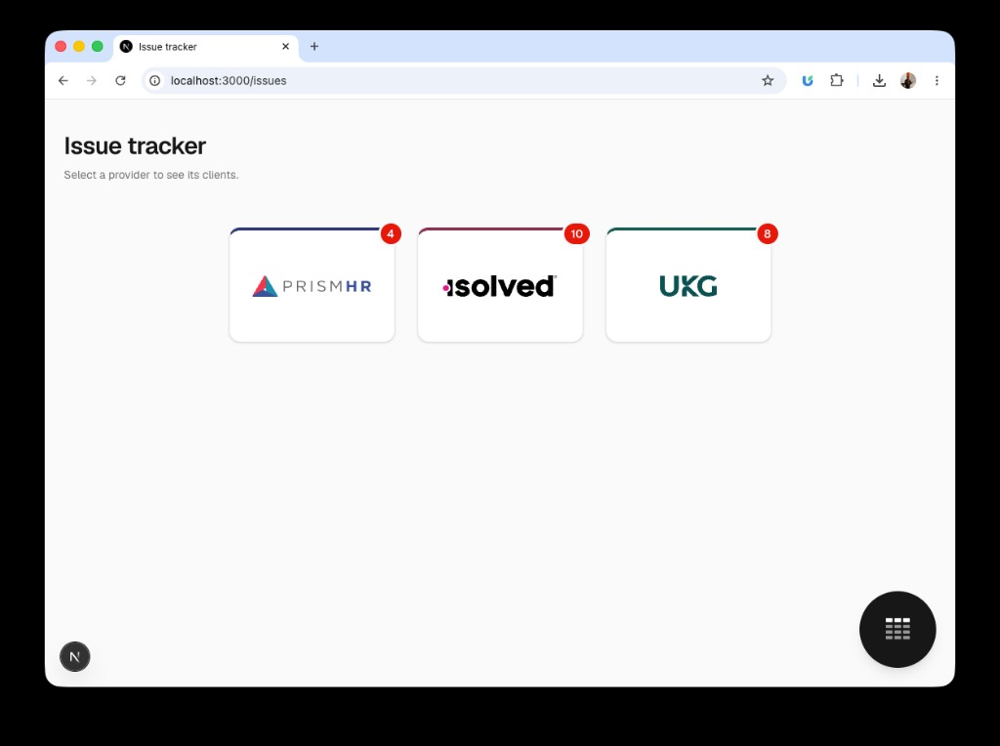
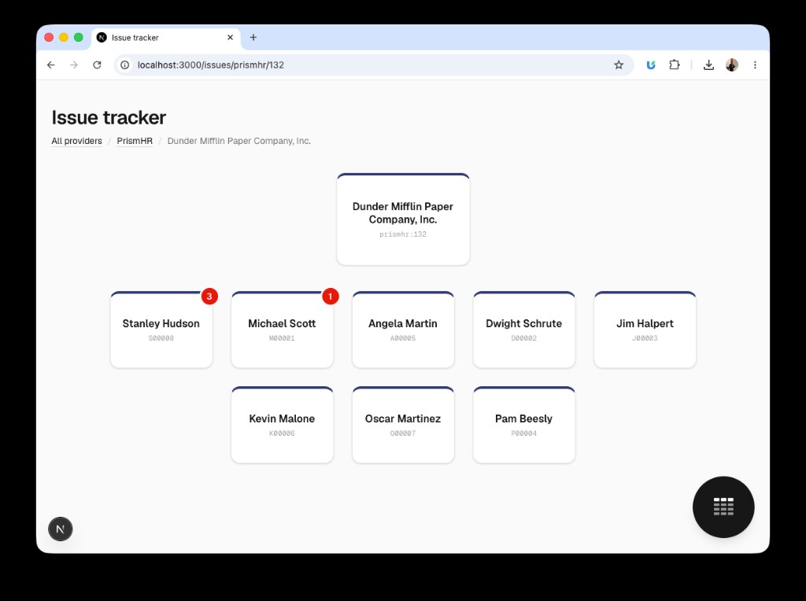
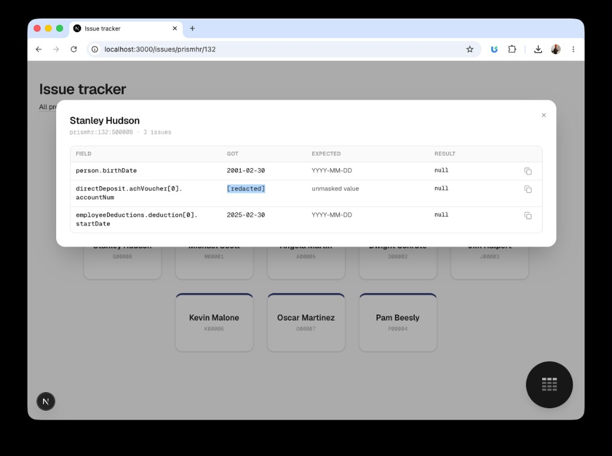
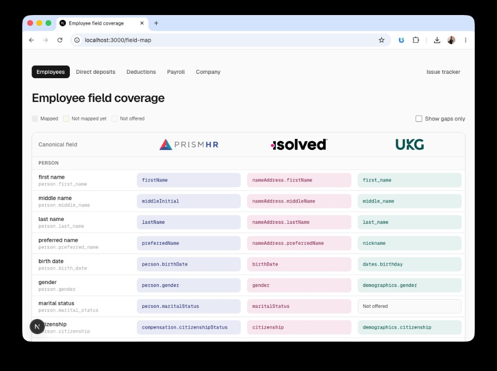

# Payroll data normalization: PrismHR, isolved and UKG Ready

Normalizes company, employee, direct deposit, deduction and payroll data from
three providers into one shared model, with records linked by key.

- Assignment: [docs/ASSIGNMENT.md](docs/ASSIGNMENT.md)
- Assumptions and decisions: [docs/DECISIONS.md](docs/DECISIONS.md)

## Quick start

Needs Python 3.10+ and Node.js 24 for the web app. No Python packages to
install.

```sh
git clone https://github.com/shreyash0k/shreyash-tada-ai-normalization-take-home.git
cd shreyash-tada-ai-normalization-take-home

# Run the tests
PYTHONPATH=src python3 -m unittest discover -s tests

# Normalize one company (swap prismhr for isolved or ukg-ready)
mkdir -p out
PYTHONPATH=src python3 -m normalization normalize-company \
  --input tests/fixtures/prismhr/ --output out/prismhr.json

# Open the web app at http://localhost:3000
cd web && npm install && npm run dev
```

## What is covered

All five data types for all three providers.

| Data type | What it holds |
| --- | --- |
| Company | Name, status, EIN, address, contacts, tax ids, work locations, pay groups |
| Employee | Profile, contact, status and dates, job and organization, current pay |
| Direct deposit | Bank, routing, account last four, type, amount or percent, priority, status, dates |
| Deduction | Code, category, amount or percent, frequency, limits, employer match, payee, dates |
| Payroll | Pay runs, and paychecks with gross, net, earnings, hours, taxes, deductions, contributions, payments |

Fields a provider does not offer are left empty; each gap is explained in
[docs/DECISIONS.md](docs/DECISIONS.md). The optional write path is not built.

## How it works

- **Input:** one JSON bundle of raw API responses per provider, company and data type (see `tests/fixtures/`).
- **One adapter per provider** in `src/normalization/adapters/` turns a bundle into shared records.
- **No guessing:** each coded field keeps the raw code, its label and the shared value; undocumented codes become `unknown`.
- **Nothing is dropped:** unused provider fields are kept in each record's `unmapped`.
- **Sensitive data:** SSNs and bank account numbers keep only their last four digits.
- **Problems are reported** as issues with a code, severity and source field.
- **Test data is synthetic,** generated from a fixed seed. Standard library only.

## The output

One JSON document per company: `company`, `employees`, `direct_deposits`,
`deductions`, `pay_runs`, `paychecks` and `issues`. Records link by
`company_key`, `employee_key` and `pay_run_key`.

## The web app

- **Issue tracker** (home): lists the records normalization could not fully map because of the source data, such as undocumented codes, invalid values or missing responses.

  
  
  

- **Field map** (bottom-right button): shows how each provider's fields map onto the canonical model.

  
